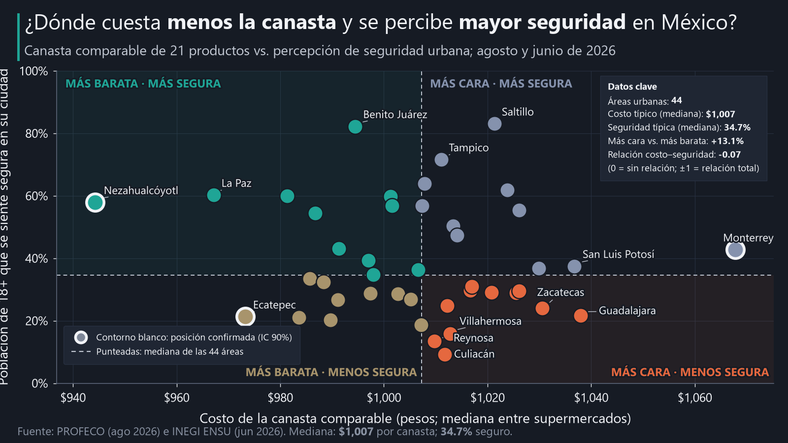

# Canasta y percepción de seguridad urbana en México

¿En qué ciudades mexicanas una canasta comparable cuesta menos y se percibe mayor
seguridad? Proyecto en Python que cruza precios de PROFECO con la Encuesta Nacional de
Seguridad Pública Urbana (ENSU) de INEGI.

## Reporte interactivo

**[Explorar los resultados, mapas y comparaciones](https://ernestrr.github.io/Most_livable_cities_mexico/)**

El reporte permite consultar las 44 áreas urbanas, comparar costo y seguridad percibida,
revisar los intervalos de incertidumbre y recorrer la tabla completa de resultados.



## Resultados

- **44 áreas urbanas** pasan todos los controles, de 72 municipios PROFECO y 91 áreas ENSU.
- Una canasta fija de **21 productos** en supermercados cuesta entre **$944** (Nezahualcóyotl)
  y **$1,068** (Monterrey). La diferencia es de **13 %**, con una mediana de $1,007.
- **La incertidumbre pesa:** el intervalo bootstrap al 90 % de cada área mide en mediana
  6 % del costo. Solo 5 de 44 áreas quedan claramente por debajo o por encima de la
  mediana: Nezahualcóyotl, Ecatepec y Tijuana por debajo; San Luis Potosí y Monterrey
  por encima.
- La seguridad percibida varía mucho más que el costo: va de **9 %** (Culiacán) a **83 %**
  (Saltillo y Benito Juárez, CDMX).
- **No se encontró evidencia estadísticamente significativa de una asociación** entre el costo de la
  canasta y la percepción de seguridad (Spearman −0.07; p por permutación 0.67).
- **Cuadrantes robustos**, es decir, con ambos intervalos del mismo lado de su mediana:
  Nezahualcóyotl (menor costo + mayor seguridad), Ecatepec (menor costo + menor seguridad)
  y Monterrey (mayor costo + mayor seguridad). Ningún área queda de forma robusta en
  «mayor costo + menor seguridad».
- Los productos con más dispersión entre ciudades son el frijol negro, la lenteja, el
  arroz, el jitomate y la cebolla. El pollo, el pan de caja y la milanesa de res casi no
  varían.
- Comparando el mismo producto en la misma ciudad, Bodega Aurrerá (y su formato Express)
  y Chedraui quedan 2–4 % por debajo de la mediana local en promedio; La Comer y HEB,
  alrededor de 9–10 % por encima.

El cuadrante solo describe dos dimensiones. No identifica «las mejores ciudades para vivir».

## Estructura

```
mexico-costo-canasta/
├── notebooks/
│   ├── 00_exploracion_profeco.ipynb      Fase 1: descripción del archivo PROFECO
│   ├── 01_auditoria_cobertura.ipynb      ENSU y homologación geográfica
│   ├── 02_canasta_comparable.ipynb       Productos, unidades, marcas, extremos
│   ├── 03_limpieza_transformacion.ipynb  Criterios de inclusión y dataset final
│   ├── 04_analisis.ipynb                 Cuadrantes, incertidumbre, dispersión, cadenas
│   └── 05_visualizaciones.ipynb          Gráficas estáticas y HTML interactivo
├── src/
│   ├── exploration.py          Lectura y auditoría de PROFECO
│   ├── cleaning.py             Tipos numéricos, fechas, unidades de la presentación
│   ├── ensu.py                 Descarga y lectura de los tabulados ENSU
│   ├── geographic_matching.py  Municipio PROFECO → área urbana ENSU
│   ├── basket.py               Canasta, precio representativo, bootstrap
│   ├── geo.py                  Límites municipales INEGI: simplificación y GeoJSON
│   ├── charts.py               Plantilla editorial de todas las gráficas (matplotlib)
│   └── visualization.py        Página HTML interactiva (Plotly) y utilidades comunes
├── data/raw/                   PROFECO (aportado), ENSU y Marco Geoestadístico (INEGI),
│                               países vecinos (Natural Earth)
├── data/processed/             Tablas intermedias y finales; geo/ con límites simplificados
├── data/metadata/              Manifiestos, parámetros y planteamiento original
├── outputs/social/             Gráfica principal 1080×1350 y 1600×900 (PNG 200 DPI y SVG)
├── outputs/charts/             13 gráficas: exploratorias (00a–01), rankings, dispersión,
│                               rango de precios por tienda, mapa de calor, cadenas, tabla y mapas municipales
├── docs/index.html             Reporte interactivo publicado en GitHub Pages
├── build_notebook.py, build_notebooks.py   Generan los notebooks 00 y 01–05
└── verify_phase1.py, verify_project.py     Verificaciones independientes
```

## Fuentes

| Fuente | Uso | Periodo |
|---|---|---|
| PROFECO, archivo `08-2026_Q2.csv` (aportado; SHA-256 en `profeco_manifest.json`) | Precios | 16–31 ago 2026 |
| INEGI ENSU, tabulados básicos, cuadro 1.7 | % de población de 18+ que se siente segura en su ciudad, con CV e IC90 | Junio 2026 |
| INEGI ENSU, microdatos (`ENSU_CB_0626.csv`) | Composición municipal de cada área urbana | Junio 2026 |
| INEGI, catálogo de ciudades ENSU 2025 (PDF) | Contraste de la composición | 4.º trim. 2025 |
| INEGI, Marco Geoestadístico 2024 (`mg_2024_integrado.zip`) | Límites municipales y estatales de los mapas | 2024 |
| Natural Earth, `ne_50m_admin_0_countries` (dominio público) | Países vecinos en los mapas | 5.x |

En los mapas municipales, **cada municipio toma el valor de su área urbana ENSU**: ni el
costo ni la seguridad se estiman por municipio.

La ENSU de junio de 2026 (levantamiento del 22 de mayo al 12 de junio) es la más reciente
publicada al 19 de octubre de 2026. La de septiembre de 2026 todavía no aparecía en el
sitio de INEGI. Para actualizar, basta cambiar las rutas en `src/ensu.py` y volver a
ejecutar los notebooks.

## Metodología

**Seguridad.** Se usa directamente el porcentaje «seguro» publicado por INEGI. No se
calcula `100 − inseguro`, porque la diferencia (0–2.5 %) corresponde a «no sabe / no
responde».

**Geografía.** PROFECO identifica municipios y ENSU áreas urbanas, que pueden abarcar
varios municipios (Toluca incluye 6; Tlaxcala, 21). Cada municipio PROFECO se lleva a su
clave INEGI y se ubica en el área ENSU que lo contiene, según los microdatos. Para cada
área se calcula qué parte de su población de 18 años o más vive en municipios
observados por PROFECO:

- **directa:** 95 % o más;
- **aproximada/documentada:** 40 % o más, e incluye el municipio principal del área;
- **no comparable:** el resto.

El umbral de 40 % sigue el salto observado en la distribución de coberturas: de 49 %
(Cuernavaca) a 27 % (Tlaxcala). Cinco nombres de PROFECO se tradujeron al nombre oficial
con una tabla explícita, por ejemplo «Tlaquepaque» → «San Pedro Tlaquepaque».
Detalle en `homologacion_geografica.csv`.

**Canasta.**

- Solo supermercados y tiendas de autoservicio.
- 22 candidatos de consumo común, cada uno definido como producto + lista cerrada de
  presentaciones equivalentes. Las unidades se extraen del texto de la presentación y se
  normalizan a kg, litro o pieza. Las presentaciones ambiguas se descartan.
- Composición completa obligatoria y sin imputar faltantes.
- Se retiró el bolillo, porque era el único faltante en Culiacán y Cuernavaca.
  Lista final en `canasta_definicion.csv`.

**Precio representativo.**

- Mediana por establecimiento y después mediana entre establecimientos del área.
- Marcas: opción A (cualquier marca). La opción B (misma marca) y la media se conservan
  como sensibilidad. Ordenan las áreas de forma parecida (Spearman 0.83 y 0.81) y
  coinciden en la mitad de costo en 79 % y 77 % de los casos.
- Los extremos se marcan por IQR dentro de cada producto y no se eliminan.

**Criterios de inclusión** (`auditoria_cobertura.csv` explica cada exclusión):

1. Correspondencia geográfica válida.
2. Al menos 3 supermercados en el área.
3. Los 21 productos presentes.
4. Como máximo 2 productos con precio de un solo establecimiento.
5. CV de la estimación ENSU menor a 30 %.

**Cuadrantes.** Se cortan en las medianas del grupo. Un cuadrante es «robusto» cuando
el IC90 bootstrap del costo y el IC90 oficial de la seguridad quedan del mismo lado de
su mediana.

## Cobertura

| Etapa | Unidades |
|---|---|
| Municipios PROFECO | 72 |
| Con correspondencia geográfica | 63 municipios → 55 áreas ENSU |
| Con supermercados PROFECO | 52 áreas |
| Con 3 o más supermercados | 45 áreas |
| Dataset final | **44 áreas** |

Excluidas, con su motivo:

- Seis municipios del Estado de México y Solidaridad (Q. Roo): fuera de las áreas ENSU.
- Tlaxcala y Apizaco: cubren solo 27 % de su área.
- Guadalupe y General Escobedo (N. L.) y Tlaquepaque: sin supermercados en PROFECO.
- Zapopan, Tonalá, San Nicolás, Iztacalco, Xochimilco, Magdalena Contreras y Pachuca:
  menos de 3 supermercados.
- Chihuahua: 5 productos con precio de un solo establecimiento.

## Archivos principales en `data/processed/`

| Archivo | Contenido |
|---|---|
| `homologacion_geografica.csv` | Municipio PROFECO → área ENSU, tipo de correspondencia y cobertura |
| `ensu_percepcion_areas.csv`, `ensu_composicion_areas.csv` | Indicador ENSU con CV e IC; municipios por área |
| `canasta_definicion.csv`, `cobertura_canasta_matriz.csv` | Productos, presentaciones y cobertura |
| `precios_area_producto.csv`, `observaciones_canasta.csv` | Precios por área y producto; observaciones usadas |
| `canasta_municipio.csv` | Costo de la canasta por área (vacío si la composición está incompleta) |
| `auditoria_cobertura.csv` | Por qué cada municipio aparece o no |
| `dataset_final.csv` | Una fila por área comparable |
| `resultados_analisis.csv` | Dataset final más IC bootstrap y cuadrantes |
| `comparacion_metodos_canasta.csv`, `dispersion_productos.csv`, `comparacion_cadenas.csv` | Sensibilidad y análisis complementarios |

Los archivos de la fase 1 (`cobertura_*_profeco.csv`, `controles_calidad_profeco.csv`,
etc.) describen el archivo PROFECO completo: 657,602 registros, 30 entidades, 72
municipios, 1,857 establecimientos y 0 duplicados exactos.

## Limitaciones

- PROFECO no es una muestra estadísticamente representativa de todos los
  establecimientos. Con unos 5 supermercados por área, la composición de cadenas influye
  en el costo.
- ENSU mide áreas urbanas y PROFECO municipios. En 13 de las 44 áreas finales la
  correspondencia es aproximada: PROFECO cubre entre 49 % y 95 % de su población.
- Los precios (agosto) y la ENSU (junio) no coinciden en fecha. Solo hay 12 días de
  precios, no un mes completo.
- La canasta no está ponderada por consumo (no se usó la ENIGH) y no equivale al costo
  de vida. Excluye vivienda, transporte, servicios y alimentos fuera de supermercado.
- La percepción de seguridad no es calidad de vida ni incidencia delictiva.
- Ningún resultado implica causalidad.
- La URL oficial del archivo PROFECO está pendiente de documentar.
